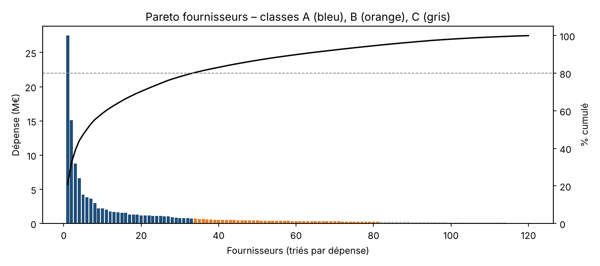
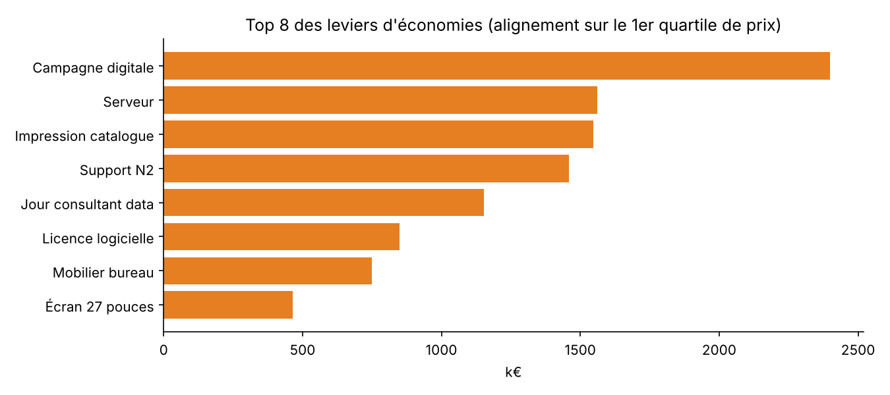

# 📦 Procurement Spend Analytics – où partent les dépenses achats ?

[](https://github.com/MERVEILLEKAMDEM/procurement-spend-analytics/actions)

Analyse de **12 000 commandes** sur un an (données fictives) pour répondre aux questions d'une direction Achats : qui sont les fournisseurs clés, quelle part des achats échappe aux contrats, et combien peut-on économiser ?



## Résultats clés

| Indicateur | Valeur |
|---|---|
| Dépense totale | 131,5 M€ |
| Fournisseurs | 120 |
| Classe A (80 % de la dépense) | 33 fournisseurs, soit 28 % du panel |
| Dépense hors contrat (maverick buying) | 25,7 M€, soit 19,5 % |
| Économie potentielle en alignant les prix sur le 1er quartile | 12,1 M€, soit 9,2 % |
| Concentration (indice HHI) par catégorie | 650 à 733, marché peu concentré |



## Méthode

1. **Classification ABC (Pareto)** des fournisseurs selon leur poids dans la dépense.
2. **Indice Herfindahl-Hirschman** par catégorie. Sous 1 500, la dépense est éclatée et peut être regroupée pour mieux négocier.
3. **Achats hors contrat** : commandes passées chez des fournisseurs non référencés.
4. **Écarts de prix** : pour un même article, le prix varie de 70 à 85 % selon le fournisseur. L'économie est estimée en ramenant chaque prix au 1er quartile observé, une cible prudente et atteignable.
5. **Livrable Excel** prêt pour un acheteur : onglets KPI, ABC, Concentration, Écarts de prix et Hors contrat.

## Recommandations tirées de l'analyse

- Négocier en priorité **Campagne digitale, Serveur et Impression catalogue**, les trois premiers leviers.
- Référencer les gros fournisseurs hors contrat pour réduire les 19,5 % de maverick buying.
- Regrouper les volumes : aucune catégorie n'est concentrée, ce qui laisse de la marge pour consolider le panel.

## Lancer le projet

```bash
pip install -r requirements.txt
python src/spend_analysis.py
```

Sorties : `results/spend_analysis.xlsx`, `results/figures/*.png`, `data/commandes.csv`.

---
Pascale KAMDEM · Data & IA · [LinkedIn](https://www.linkedin.com/in/merveille-kamdem-562aa0284/)
